[English](README.md) | [Português (Brasil)](README.pt-BR.md) | **Español**

# Clon del R36S (GA36-MB V1.2): fábrica de imágenes de tarjeta SD

Una consola portátil retro más amigable para un niño de 6 años.

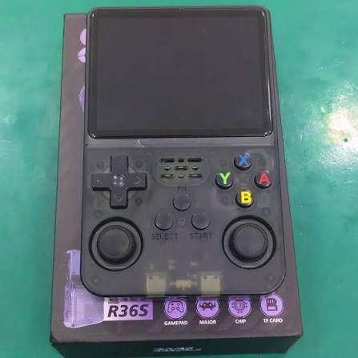

*Imagen ilustrativa del R36S.*

## Por qué existe este proyecto

Mantengo este repositorio para mi hijo de 6 años. Le regalaron un clon barato del R36S
y quería que pudiera encenderlo, encontrar un juego y abrirlo **solo**. Por eso cada
cambio aquí pasa por una pregunta: ¿ayuda a un niño pequeño en esta pantalla?

Eso significa todo en pantalla en su idioma, menos avisos y animaciones entre encender
y jugar, imagen y sonido agradables y un menú simple.

## De dónde viene la imagen base

Los clones de esta placa solo arrancan con la imagen de fábrica **EmuELEC 4.7 "Nexus"**.
Uso la que se compartió en esta publicación de r/R36S:
<https://www.reddit.com/r/R36S/comments/1w2i8em/r36s_ga36mb_v1220260416_emuelec_no_roms/>

La imagen base nunca se modifica. La compilación parte siempre de ella y cambia solo lo
que es seguro: archivos de las particiones de sistema, storage y ROMs. Cada cambio
pedido se convierte en una *feature* versionada, y cada compilación genera una imagen
nueva, identificada por la hora en que se generó. La imagen base no está incluida en
este repositorio.

## El clon y su hardware

Esta placa **no** es Rockchip como el R36S original, aunque se venda con ese nombre. Lo
que se verificó en este dispositivo:

| Ítem | Valor |
|------|-------|
| SoC | Allwinner A33 (4x Cortex-A7), remarcado como RK3326 |
| RAM | 1 GB |
| GPU | Mali-400 MP2 |
| Pantalla | 3,5", 640x480 |
| Sistema | EmuELEC 4.7 "Nexus" (kernel sunxi 3.4.39) |
| Red | ninguna (sin Wi-Fi, sin SSH) |

- Las imágenes genéricas de R36S (ArkOS, AmberELEC, ROCKNIX...) son para Rockchip y
  **no arrancan** aquí.
- El código fuente de este fork de EmuELEC no es público, así que el sistema no se puede
  recompilar; solo se reemplazan archivos de las particiones.
- Todo entra y sale por la tarjeta SD, leída en la PC.
- Batería: la capacidad nominal es desconocida. En una descarga completa medida el 26/10,
  el dispositivo duró 264 min y entregó 2640 mAh.

## Features y corrección de bugs

- **Idioma:** la compilación elige el idioma del sistema, de EmulationStation y del menú
  de RetroArch (`./build.sh --idioma <código>`, inglés por defecto). Incluye
  traducciones completas de EmulationStation al portugués de Brasil y al español
  latino.
- **Tema:** `Epic Cody ML`, versión multilingüe del tema Epic Cody.
- **Arranque limpio:** una sola pantalla con el ícono de control, del arranque al juego.
- **Imagen:** shaders para GBA, Game Boy y Game Boy Color (activados por defecto) y un
  shader de TV opcional para consolas de 8/16 bits y arcades.
- **Corregidos el ghosting del GBA** (mezcla de cuadros del LCD en gpSP) y el **audio
  con chasquidos**.
- **Sonido:** una única cadena de ganancia de audio, de modo que el volumen 0 realmente
  silencia y el volumen guardado se aplica al arrancar, después de los juegos y al
  despertar.
- **Controles:** los botones de cara siguen su posición física en RetroArch y el botón
  **FN** funciona como hotkey.
- **Brillo:** FN + D-pad arriba/abajo, recordado entre arranques.
- **Batería:** porcentaje corregido, basado en una descarga medida.
- **Sistema más liviano:** swap en zram, menos servicios al arrancar, `noatime` en la
  partición de ROMs y un governor de CPU ajustado.
- **Cores recompilados para el A33** (por ejemplo, SNES) y mejor rendimiento en PSP.
- **Save states con miniatura** visibles en EmulationStation.
- **Ports:** ClassiCube (recreación de Minecraft Classic), sin conexión, como "Classic
  Craft".
- **Juegos LÖVE (Love2D):** runtime LÖVE 11.5 standalone integrado en EmulationStation compatible con archivos `.love` y `.zip` en la partición de ROMs, aceleración OpenGL ES 2.0 nativa y el juego *Mr. Rescue* incluido.
- **Juegos recompilados (GBA Recomp):** un sistema listo para juegos convertidos en programas nativos (un `.sh` por juego en la carpeta `gba-recomp`), sin emulador. FN + Start cierra el juego y vuelve a EmulationStation. El conversor que crea estos juegos es un proyecto futuro.

## Atajos

En el juego (FN es el hotkey):

| Atajo | Acción |
|-------|--------|
| FN + X | Menú de RetroArch |
| FN + Y | Captura de pantalla |
| FN + L / R | Cargar / guardar estado |
| FN + L2 | Cámara lenta |
| FN + R2 | Avance rápido |
| FN + abajo | Pausa |
| FN + derecha | Mostrar FPS |
| FN + Start | Salir |

Brillo (en EmulationStation y en el juego):

| Atajo | Acción |
|-------|--------|
| FN + D-pad arriba / abajo | Sube / baja el brillo (pasos de 5, de 10 a 100) |
| FN + clic del L3 | Vuelve al valor por defecto (80) |

ClassiCube: A salta, X abre el inventario, Y toma el bloque, L rompe, R coloca;
Select + Start cierra el juego y vuelve a EmulationStation.

LÖVE (Love2D): FN + Start cierra el juego y vuelve a EmulationStation.

## Motor LÖVE (Love2D)

El clon cuenta con el runtime oficial **LÖVE 11.5** standalone integrado como consola en EmulationStation.

- **Formatos aceptados:** copia archivos `.love` o paquetes comprimidos en `.zip` en la carpeta `roms/love/` en la partición `R36-ROMS` (FAT32, accesible en PC).
- **Juego de demostración:** incluye el juego de código abierto *Mr. Rescue* preinstalado con arte de portada y metadatos.
- **Controles en el juego:** botones mapeados de forma nativa mediante SDL2 (`micro_gamepad`).
- **Cómo salir del juego:** pulsa `FN + Start` en cualquier momento para volver de forma fluida a EmulationStation.

### ¿Por qué LÖVE en lugar de PICO-8?

Nos encanta profundamente la propuesta de PICO-8 y el movimiento de las *fantasy consoles*: la creatividad de los desarrolladores independientes, las limitaciones encantadoras y la pura diversión de los juegos creados por la comunidad son inspiradoras. Sin embargo, en el complejo ecosistema de clones del R36S, el PICO-8 oficial es software propietario cerrado, y sus emuladores o capas de compatibilidad sufren con frecuencia de problemas de estabilidad, fallos de audio o incompatibilidades según el SoC o la revisión de placa (como este clon con Allwinner A33).

**LÖVE 11.5** resuelve esto por completo:
- **100% libre y de código abierto:** compilado nativamente para el hardware con aceleración Mali-400 GLES2 y LuaJIT.
- **Portabilidad universal:** funciona con total estabilidad en todas las variantes y revisiones del R36S, sin depender de binarios externos cerrados.
- **Resolución nativa de 640x480:** aprovecha cada píxel de la pantalla IPS con nitidez absoluta, sin el recorte ni escalado forzado de 128x128.
- **Libertad creativa:** conserva toda la magia de crear juegos en Lua con físicas fluidas, sonido estéreo cristalino y margen para proyectos mucho más ambiciosos.

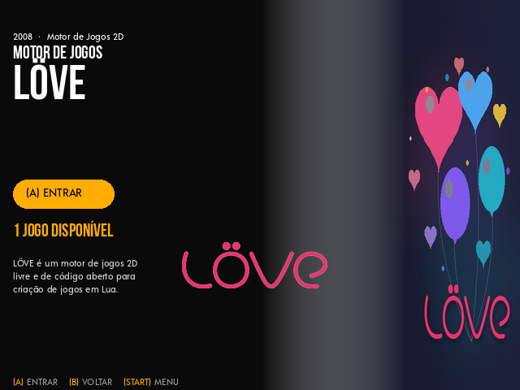

### Para desarrolladores (soporte de idioma)

El iniciador de LÖVE exporta el idioma activo del sistema (`CONSOLE_LANG`, `CONSOLE_LANG_SHORT`, `LANG`, `LANGUAGE` y `/tmp/console_lang`). Tus juegos en Lua pueden detectar el idioma de la consola y cambiar tablas de texto automáticamente, asegurando un fallback seguro al inglés si la traducción no existe:

```lua
-- Ejemplo de detección de idioma con fallback seguro
local lang = os.getenv("CONSOLE_LANG") or os.getenv("LANG") or "en_US"
local code = lang:sub(1, 2):lower() -- 'pt', 'en', 'es'

local translations = {
    pt = { start = "Iniciar Jogo", quit = "Sair" },
    es = { start = "Iniciar Juego", quit = "Salir" },
    en = { start = "Start Game",   quit = "Quit" },
}

local text = translations[code] or translations["en"]
```

## Mejoras en imágenes

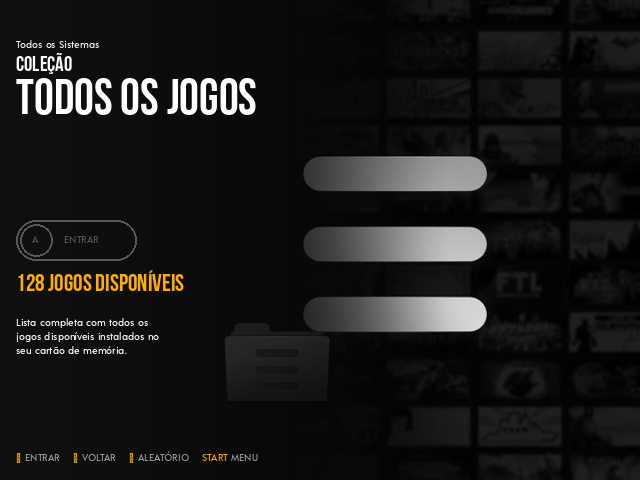
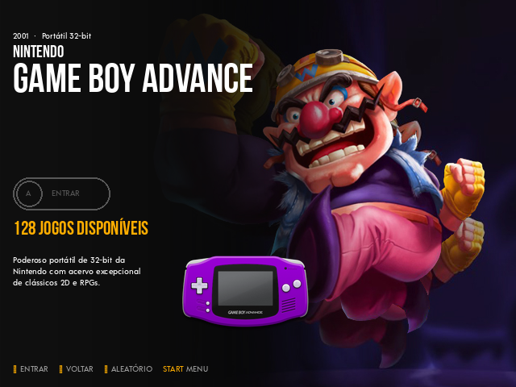
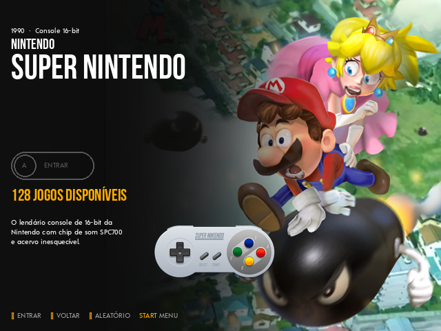
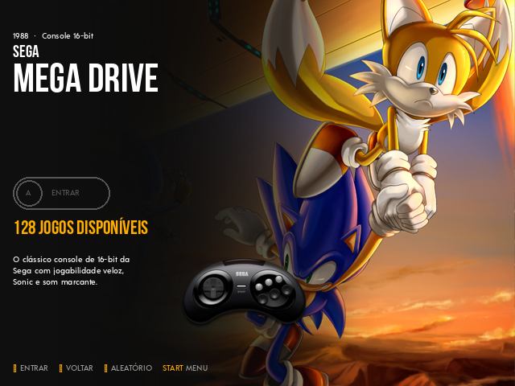
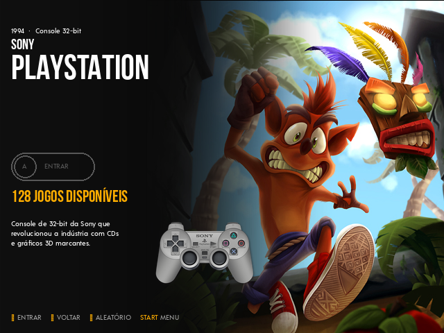

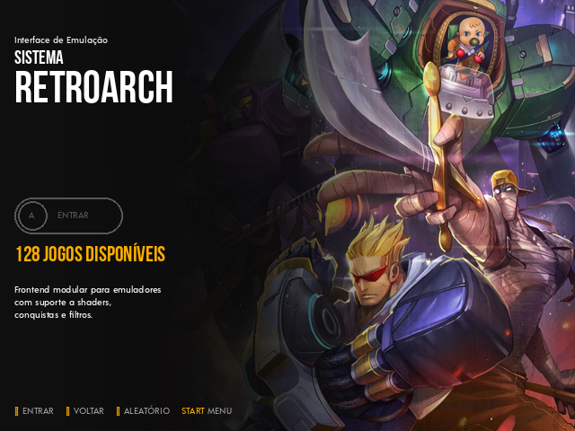

Shader del GBA, con y sin él (Mario Kart):

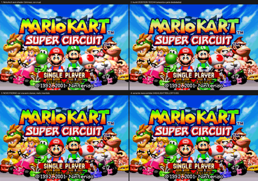

Shader del Game Boy Color:

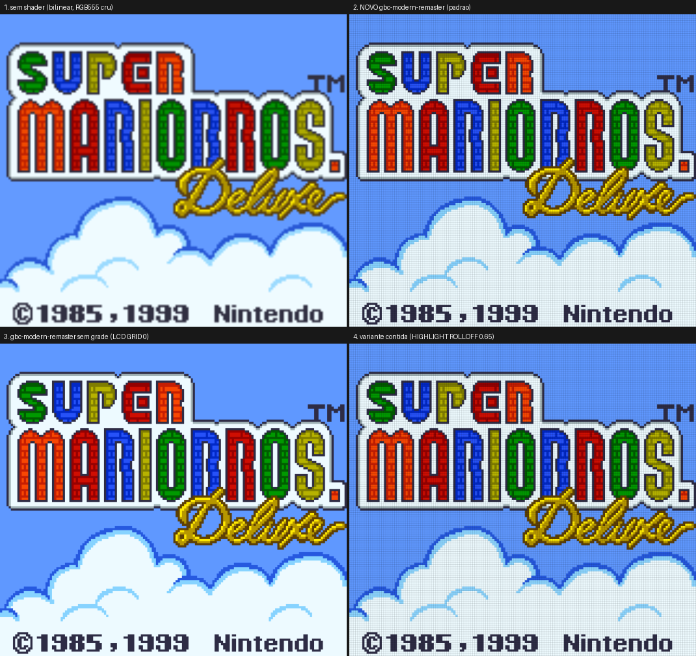

Shader de TV opcional para Mega Drive y otras consolas (Sonic):

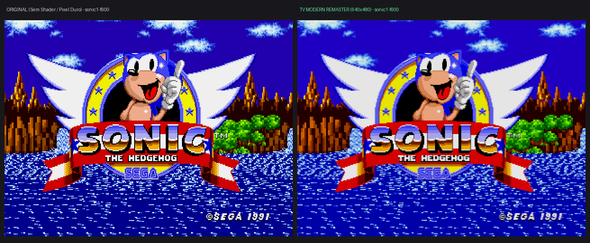

## Cómo grabar

Requiere Linux con Python 3.11 o más nuevo y `squashfs-tools`, `mtools`, `dosfstools`,
`e2fsprogs`, `util-linux`, `xz` y `coreutils`. Pon la imagen base en `base/` y ejecuta:

```bash
./build.sh               # inglés
./build.sh --lang pt_BR  # portugués de Brasil
./build.sh --lang es_ES  # español
```

La imagen aparece en `out/<timestamp>/`; grábala con Etcher o con `./flash.sh`. Detalles
completos: [docs/DESARROLLO.md](docs/DESARROLLO.md).

## Desarrollador

Douglas Panhota: <douglaspands@gmail.com>

## Créditos y aviso

Gracias a los proyectos en los que esto se apoya: [EmuELEC](https://github.com/EmuELEC/EmuELEC),
el tema Epic Cody, [Libretro / RetroArch](https://www.libretro.com/),
[ClassiCube](https://www.classicube.net/) y [LÖVE](https://love2d.org/). Este repositorio no declara ninguna licencia
y no promete términos de uso para el software de terceros mencionado. La foto del
dispositivo es solo ilustrativa y su autor es desconocido.
