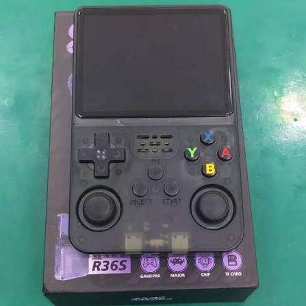
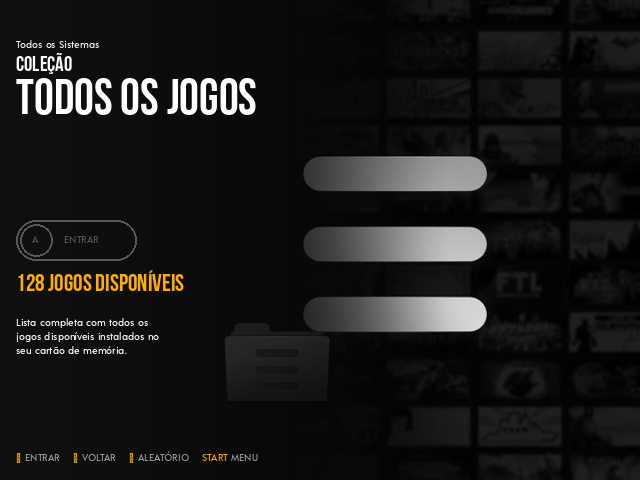
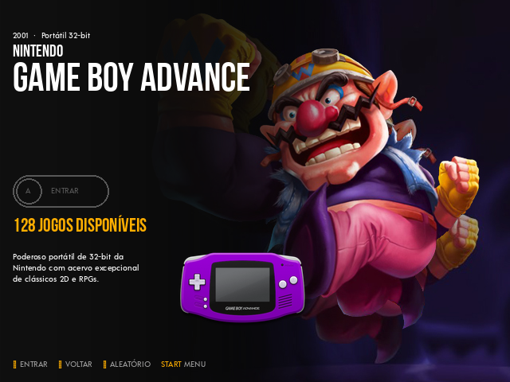
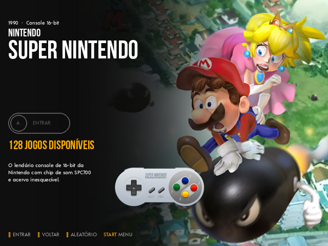
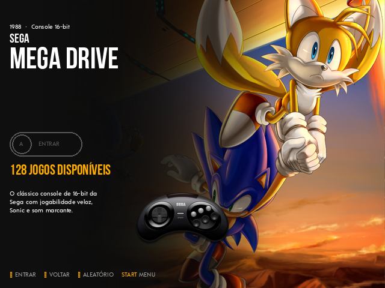
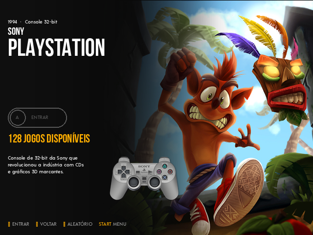
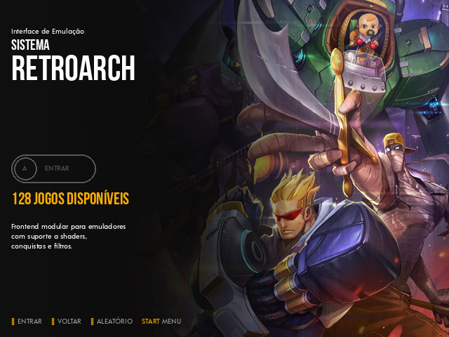
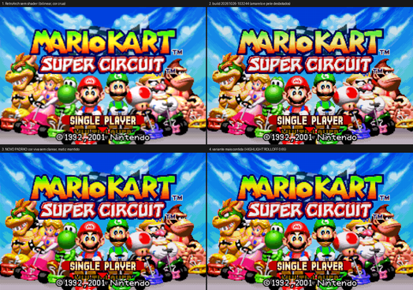
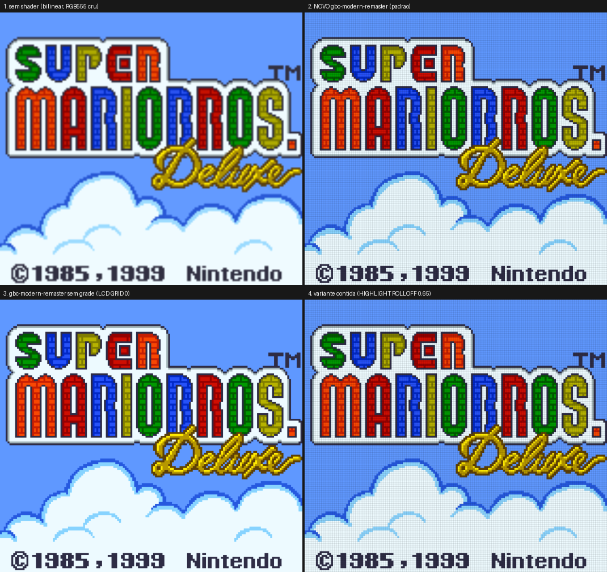
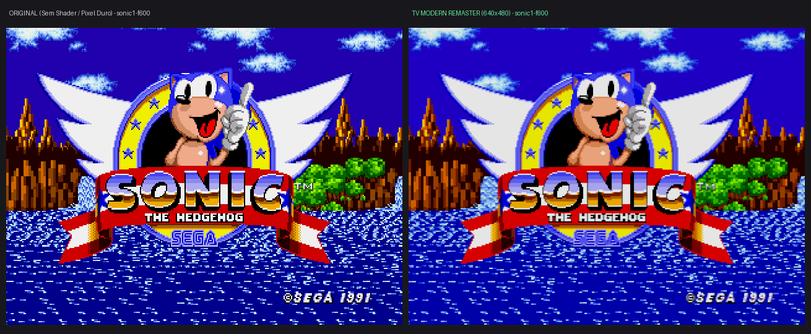

**English** | [Português (Brasil)](README.pt-BR.md) | [Español](README.es.md)

# R36S clone (GA36-MB V1.2): an SD card image factory

A retro handheld made friendlier for a 6-year-old kid.



*Illustrative image of the R36S.*

## Why this project exists

I maintain this repository for my 6-year-old son. He got a cheap R36S clone, and I
wanted him to be able to turn it on, find a game and open it **by himself**. So every
change here is judged by one question: does it help a small child on this screen?

That means everything on screen in his own language, fewer warnings and animations
between power-on and playing, pleasant picture and sound, and a simple menu.

## Where the base image comes from

Clones of this board only boot the factory **EmuELEC 4.7 "Nexus"** image. I use the
one shared in this r/R36S post:
<https://www.reddit.com/r/R36S/comments/1w2i8em/r36s_ga36mb_v1220260416_emuelec_no_roms/>

The base image is never modified. The build starts from it every time and swaps only
what is safe to swap: files of the system, storage and ROMs partitions. Each requested
change becomes a versioned *feature*, and each build generates a new image stamped with
the time it was made. The base image is not included in this repository.

## The clone and its hardware

This board is **not** a Rockchip like the original R36S, even though it is sold under
that name. What was verified on this device:

| Item | Value |
|------|-------|
| SoC | Allwinner A33 (4x Cortex-A7), relabeled as RK3326 |
| RAM | 1 GB |
| GPU | Mali-400 MP2 |
| Screen | 3.5", 640x480 |
| System | EmuELEC 4.7 "Nexus" (sunxi kernel 3.4.39) |
| Network | none (no Wi-Fi, no SSH) |

- Generic R36S images (ArkOS, AmberELEC, ROCKNIX...) are for Rockchip and **do not boot**
  here.
- The source of this EmuELEC fork is not public, so the system cannot be rebuilt; only
  files on the partitions can be replaced.
- Everything goes in and out through the SD card, read on a PC.
- Battery: the nominal capacity is unknown. In a full discharge measured on 26/10 the
  device ran for 264 min and delivered 2640 mAh.

## Features and bug fixes

- **Language:** the build picks the language of the system, EmulationStation and the
  RetroArch menu (`./build.sh --idioma <code>`, English by default). Full Brazilian
  Portuguese and Latin American Spanish translations of EmulationStation are included.
- **Theme:** `Epic Cody ML`, a multilingual version of the Epic Cody theme.
- **Clean boot:** a single controller-icon screen from boot to game.
- **Picture:** shaders for GBA, Game Boy and Game Boy Color (on by default), and an optional
  TV shader for 8/16-bit consoles and arcades.
- **Fixed GBA ghosting** (LCD blending in gpSP) and **crackling audio**.
- **Sound:** a single audio gain chain, so volume 0 really is silent and the saved volume
  is applied at boot, after games, and on wake.
- **Controls:** face buttons follow their physical position in RetroArch and the **FN**
  button works as the hotkey.
- **Brightness:** FN + D-pad up/down, remembered across reboots.
- **Battery:** corrected percentage, based on a measured discharge.
- **Lighter system:** zram swap, fewer boot services, `noatime` on the ROMs partition
  and a tuned CPU governor.
- **Cores recompiled for the A33** (for example SNES) and better PSP performance.
- **Save states with thumbnails** visible in EmulationStation.
- **Ports:** ClassiCube (a Minecraft Classic remake), offline, as "Classic Craft".
- **LÖVE (Love2D) games:** standalone LÖVE 11.5 runtime integrated into EmulationStation supporting `.love` and `.zip` files on the ROMs partition, native OpenGL ES 2.0 acceleration, and the game *Mr. Rescue* included.

## Shortcuts

In game (FN is the hotkey):

| Shortcut | Action |
|----------|--------|
| FN + X | RetroArch menu |
| FN + Y | Screenshot |
| FN + L / R | Load / save state |
| FN + L2 | Slow motion |
| FN + R2 | Fast forward |
| FN + Down | Pause |
| FN + Right | Show FPS |
| FN + Start | Quit |

Brightness (in EmulationStation and in game):

| Shortcut | Action |
|----------|--------|
| FN + D-pad Up / Down | Brightness up / down (steps of 5, from 10 to 100) |
| FN + L3 click | Back to the default (80) |

ClassiCube: A jumps, X opens the inventory, Y picks a block, L breaks, R places;
Select + Start quits back to EmulationStation.

LÖVE (Love2D): FN + Start quits back to EmulationStation.

## LÖVE (Love2D) Engine

The clone includes the official standalone **LÖVE 11.5** runtime integrated as a console in EmulationStation.

- **Supported formats:** copy `.love` files or `.zip` packages to the `roms/love/` folder on the `R36-ROMS` partition (FAT32, accessible on PC).
- **Demo game:** comes with the open-source game *Mr. Rescue* pre-installed with cover art and metadata.
- **In-game controls:** native gamepad mapping via SDL2 (`micro_gamepad`).
- **How to quit:** press `FN + Start` at any time to smoothly return to EmulationStation.

### For developers (language localization)

The LÖVE launcher exports the console's active language (`CONSOLE_LANG`, `CONSOLE_LANG_SHORT`, `LANG`, `LANGUAGE`, and `/tmp/console_lang`). Your Lua games can detect the console's language and switch text tables automatically, ensuring a safe fallback to English if the translation is unavailable:

```lua
-- Language detection with safe fallback
local lang = os.getenv("CONSOLE_LANG") or os.getenv("LANG") or "en_US"
local code = lang:sub(1, 2):lower() -- 'pt', 'en', 'es'

local translations = {
    pt = { start = "Iniciar Jogo", quit = "Sair" },
    es = { start = "Iniciar Juego", quit = "Salir" },
    en = { start = "Start Game",   quit = "Quit" },
}

local text = translations[code] or translations["en"]
```

## Improvements in pictures








GBA shader, with and without it (Mario Kart):



Game Boy Color shader:



Optional TV shader for Mega Drive and other consoles (Sonic):



## How to flash

Requires Linux with Python 3.11 or newer and `squashfs-tools`, `mtools`, `dosfstools`,
`e2fsprogs`, `util-linux`, `xz` and `coreutils`. Put the base image in `base/` and run:

```bash
./build.sh                  # English
./build.sh --idioma pt_BR   # Brazilian Portuguese
./build.sh --idioma es_ES   # Spanish
```

The image appears in `out/<timestamp>/`; flash it with Etcher or `./flash.sh`. Full
details (in Portuguese): [docs/DESENVOLVIMENTO.md](docs/DESENVOLVIMENTO.md).

## Developer

Douglas Panhota: <douglaspands@gmail.com>

## Credits and notice

Thanks to the projects this builds on: [EmuELEC](https://github.com/EmuELEC/EmuELEC),
the Epic Cody theme, [Libretro / RetroArch](https://www.libretro.com/),
[ClassiCube](https://www.classicube.net/) and [LÖVE](https://love2d.org/). This repository does not state any license
and promises no terms of use for the third-party software above. The device photo is
only illustrative and its author is unknown.
