[English](README.md) | **Português (Brasil)** | [Español](README.es.md)

# Clone do R36S (GA36-MB V1.2): fábrica de imagens de cartão SD

Um portátil retrô mais amigável para uma criança de 6 anos.

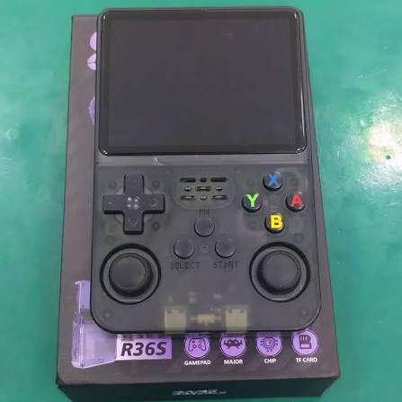

*Imagem ilustrativa do R36S.*

## Por que este projeto existe

Mantenho este repositório para o meu filho de 6 anos. Ele ganhou um clone barato do
R36S, e eu queria que ele conseguisse ligar, achar um jogo e abri-lo **sozinho**. Por
isso toda mudança aqui passa por uma pergunta: ajuda uma criança pequena nesta tela?

Isso significa tudo na tela na língua dele, menos avisos e animações entre ligar e
jogar, imagem e som agradáveis e um menu simples.

## De onde vem a imagem base

Os clones desta placa só dão boot com a imagem de fábrica **EmuELEC 4.7 "Nexus"**. Uso a
que foi compartilhada neste post do r/R36S:
<https://www.reddit.com/r/R36S/comments/1w2i8em/r36s_ga36mb_v1220260416_emuelec_no_roms/>

A imagem base nunca é modificada. O build parte dela sempre e troca só o que é seguro:
arquivos das partições de sistema, storage e ROMs. Cada mudança pedida vira uma
*feature* versionada, e cada build gera uma imagem nova, identificada pelo horário em
que foi gerada. A imagem base não está incluída neste repositório.

## O clone e o hardware

Esta placa **não** é Rockchip como o R36S original, embora seja vendida com esse nome.
O que foi verificado neste aparelho:

| Item | Valor |
|------|-------|
| SoC | Allwinner A33 (4x Cortex-A7), remarcado como RK3326 |
| RAM | 1 GB |
| GPU | Mali-400 MP2 |
| Tela | 3,5", 640x480 |
| Sistema | EmuELEC 4.7 "Nexus" (kernel sunxi 3.4.39) |
| Rede | nenhuma (sem Wi-Fi, sem SSH) |

- Imagens genéricas de R36S (ArkOS, AmberELEC, ROCKNIX...) são para Rockchip e **não dão
  boot** aqui.
- O código-fonte deste fork do EmuELEC não é público, então o sistema não pode ser
  recompilado; só se trocam arquivos das partições.
- Tudo entra e sai pelo cartão SD, lido no PC.
- Bateria: a capacidade nominal é desconhecida. Numa descarga completa medida em 26/10,
  o aparelho durou 264 min e entregou 2640 mAh.

## Features e correções de bugs

- **Idioma:** o build escolhe o idioma do sistema, do EmulationStation e do menu do
  RetroArch (`./build.sh --idioma <código>`, inglês por padrão). Inclui traduções
  completas do EmulationStation para português do Brasil e espanhol latino.
- **Tema:** `Epic Cody ML`, versão multilíngue do tema Epic Cody.
- **Boot limpo:** uma única tela com o ícone de controle, do boot até o jogo.
- **Imagem:** shaders para GBA, Game Boy e Game Boy Color (ligados por padrão) e um
  shader de TV opcional para consoles de 8/16 bits e arcades.
- **Corrigidos o ghosting do GBA** (mistura de quadros do LCD no gpSP) e o **áudio com
  chiado**.
- **Som:** uma única cadeia de ganho de áudio, de modo que o volume 0 realmente silencia
  e o volume salvo é aplicado no boot, depois dos jogos e ao acordar.
- **Controles:** os botões de face seguem a posição física no RetroArch e o botão **FN**
  funciona como hotkey.
- **Brilho:** FN + D-pad cima/baixo, lembrado entre os boots.
- **Bateria:** percentual corrigido, com base em uma descarga medida.
- **Sistema mais leve:** swap em zram, menos serviços no boot, `noatime` na partição de
  ROMs e um governor de CPU ajustado.
- **Cores recompilados para o A33** (por exemplo, SNES) e melhor desempenho no PSP.
- **Save states com miniatura** visíveis no EmulationStation.
- **Ports:** ClassiCube (recriação do Minecraft Classic), offline, como "Classic Craft".
- **Jogos LÖVE (Love2D):** runtime LÖVE 11.5 standalone integrado ao EmulationStation com suporte a arquivos `.love` e `.zip` na partição de ROMs, aceleração OpenGL ES 2.0 nativa e o jogo *Mr. Rescue* incluído.

## Atalhos

No jogo (o FN é o hotkey):

| Atalho | Ação |
|--------|------|
| FN + X | Menu do RetroArch |
| FN + Y | Screenshot |
| FN + L / R | Carregar / salvar estado |
| FN + L2 | Câmera lenta |
| FN + R2 | Avanço rápido |
| FN + baixo | Pausa |
| FN + direita | Mostrar FPS |
| FN + Start | Sair |

Brilho (no EmulationStation e no jogo):

| Atalho | Ação |
|--------|------|
| FN + D-pad cima / baixo | Sobe / desce o brilho (passos de 5, de 10 a 100) |
| FN + clique do L3 | Volta ao padrão (80) |

ClassiCube: A pula, X abre o inventário, Y pega o bloco, L quebra, R coloca;
Select + Start fecha o jogo e volta ao EmulationStation.

LÖVE (Love2D): FN + Start fecha o jogo e volta ao EmulationStation.

## Motor LÖVE (Love2D)

O clone conta com o runtime oficial **LÖVE 11.5** standalone integrado como um console no EmulationStation.

- **Formatos aceitos:** copie arquivos `.love` ou pacotes compactados em `.zip` para a pasta `roms/love/` na partição `R36-ROMS` (FAT32, acessível no PC).
- **Jogo de demonstração:** acompanha o jogo open-source *Mr. Rescue* pré-instalado com arte de capa e metadados.
- **Controles no jogo:** botões mapeados nativamente via SDL2 (`micro_gamepad`).
- **Como sair do jogo:** pressione `FN + Start` a qualquer momento para retornar suavemente ao EmulationStation.

### Por que LÖVE em vez de PICO-8?

Amamos de coração a proposta do PICO-8 e o movimento dos *fantasy consoles*: a criatividade dos desenvolvedores indie, as limitações charmosas e a diversão pura dos jogos criados pela comunidade são inspiradoras. No entanto, no ecossistema dos clones de R36S, o PICO-8 oficial é um software proprietário fechado, e seus emuladores e camadas de compatibilidade frequentemente sofrem com incompatibilidades de arquitetura, problemas de desempenho, falhas de áudio ou quebras completas dependendo do SoC ou lote específico de hardware (como este clone com Allwinner A33).

O **LÖVE 11.5** resolve isso de ponta a ponta:
- **100% livre e de código aberto:** compilado nativamente para o hardware com aceleração GLES2 Mali-400 e LuaJIT.
- **Portabilidade universal:** roda com estabilidade impecável em todas as placas e revisões do R36S, sem travar nem depender de binários obscuros.
- **Resolução total de 640x480:** aproveita cada pixel da tela IPS com nitidez impecável, sem o corte ou esticamento forçado de 128x128.
- **Liberdade criativa:** mantém toda a magia de programar jogos em Lua com física, som estéreo límpido e suporte a jogos muito mais ricos.

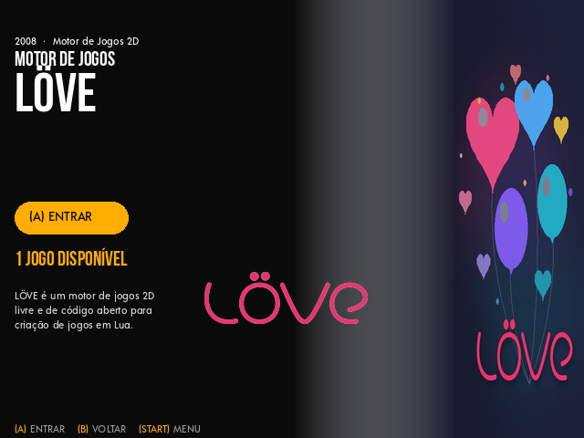

### Para desenvolvedores (suporte a idioma)

O inicializador do LÖVE exporta o idioma ativo do sistema (`CONSOLE_LANG`, `CONSOLE_LANG_SHORT`, `LANG`, `LANGUAGE` e `/tmp/console_lang`). Seus jogos em Lua podem detectar o idioma do console e alternar tabelas de texto automaticamente, garantindo fallback limpo para inglês se a tradução não existir:

```lua
-- Exemplo de detecção de idioma com fallback seguro
local lang = os.getenv("CONSOLE_LANG") or os.getenv("LANG") or "en_US"
local code = lang:sub(1, 2):lower() -- 'pt', 'en', 'es'

local translations = {
    pt = { start = "Iniciar Jogo", quit = "Sair" },
    es = { start = "Iniciar Juego", quit = "Salir" },
    en = { start = "Start Game",   quit = "Quit" },
}

local text = translations[code] or translations["en"]
```

## Melhorias em imagens

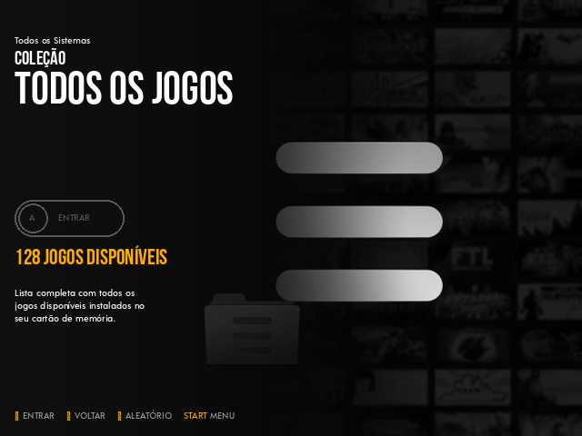
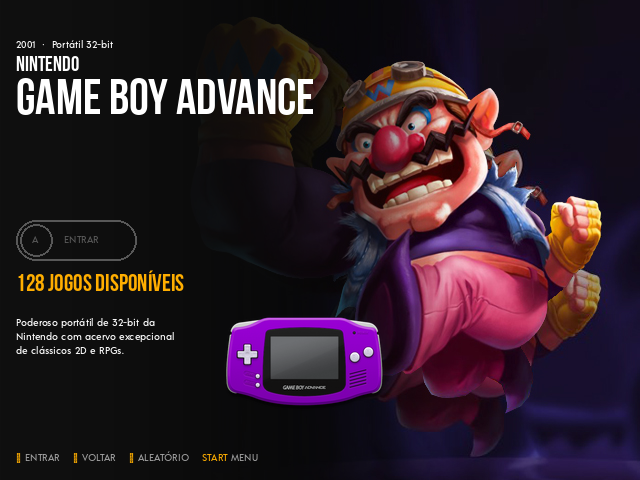
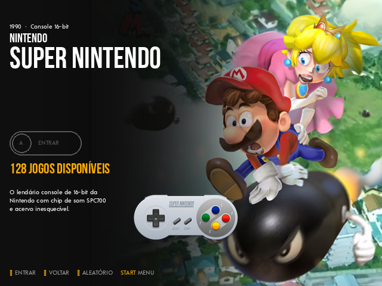
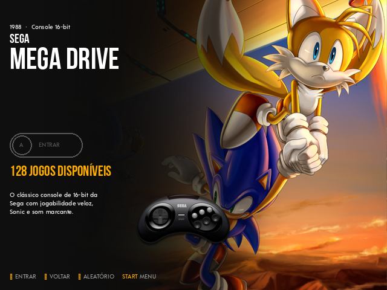
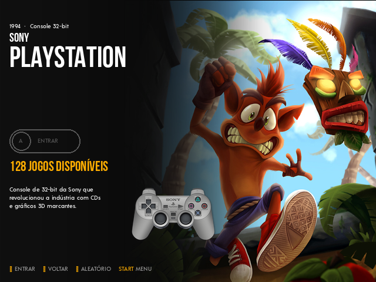

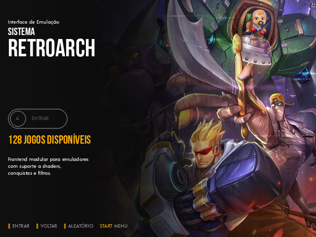

Shader do GBA, com e sem ele (Mario Kart):

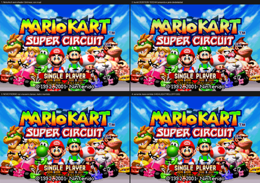

Shader do Game Boy Color:

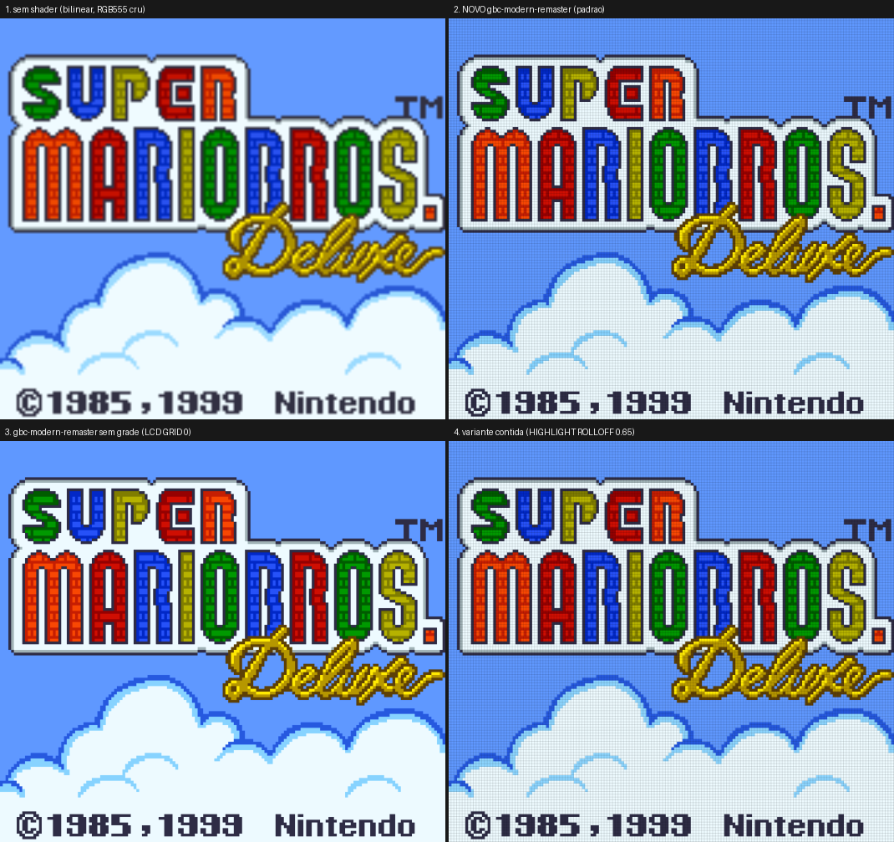

Shader de TV opcional para Mega Drive e outros consoles (Sonic):

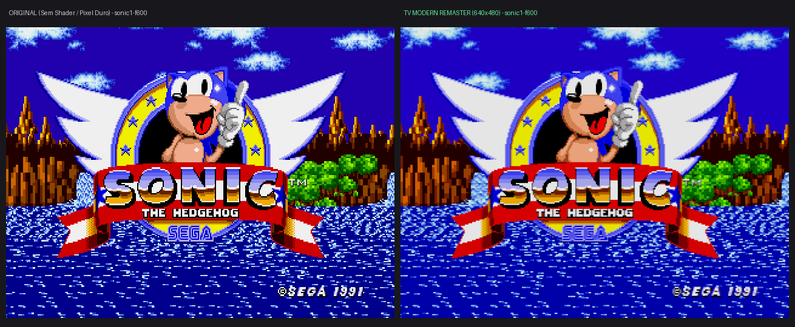

## Como gravar

Exige Linux com Python 3.11 ou mais novo e `squashfs-tools`, `mtools`, `dosfstools`,
`e2fsprogs`, `util-linux`, `xz` e `coreutils`. Ponha a imagem base em `base/` e rode:

```bash
./build.sh               # inglês
./build.sh --lang pt_BR  # português do Brasil
./build.sh --lang es_ES  # espanhol
```

A imagem aparece em `out/<timestamp>/`; grave com o Etcher ou o `./flash.sh`. Detalhes
completos: [docs/DESENVOLVIMENTO.md](docs/DESENVOLVIMENTO.md).

## Desenvolvedor

Douglas Panhota: <douglaspands@gmail.com>

## Créditos e aviso

Obrigado aos projetos em que isto se apoia: [EmuELEC](https://github.com/EmuELEC/EmuELEC),
o tema Epic Cody, [Libretro / RetroArch](https://www.libretro.com/),
[ClassiCube](https://www.classicube.net/) e [LÖVE](https://love2d.org/). Este repositório não declara nenhuma licença
e não promete termos de uso para os softwares de terceiros acima. A foto do aparelho é
apenas ilustrativa e o autor é desconhecido.
